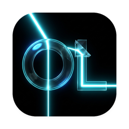
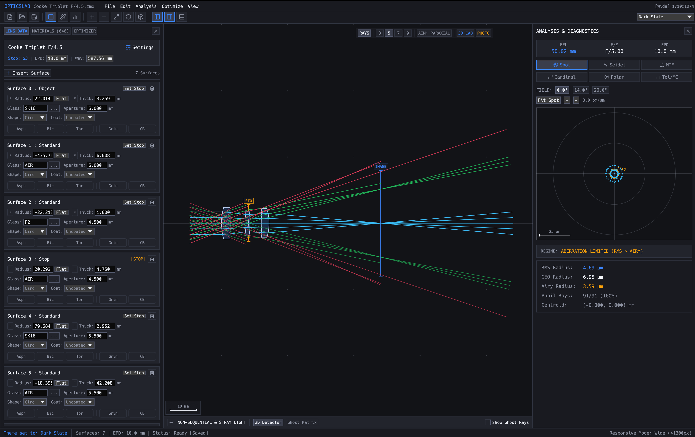
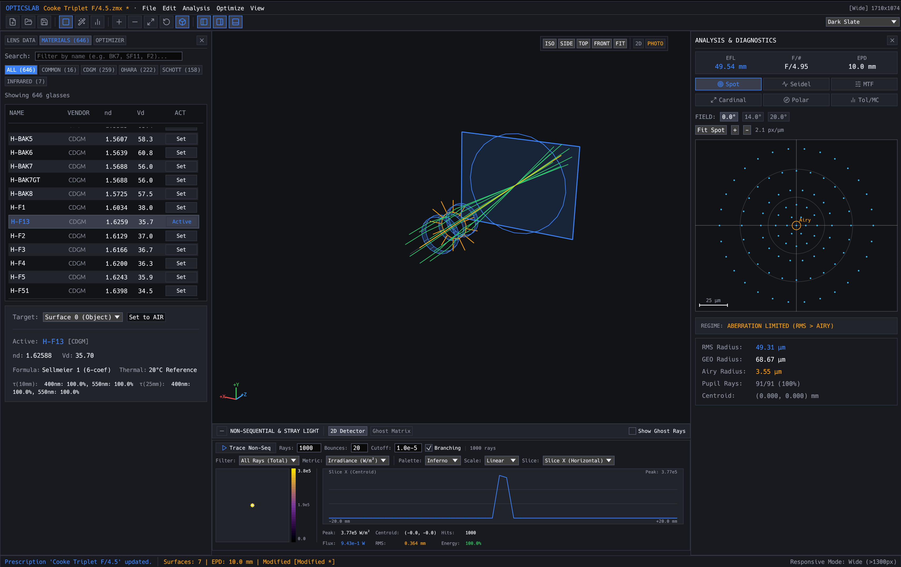
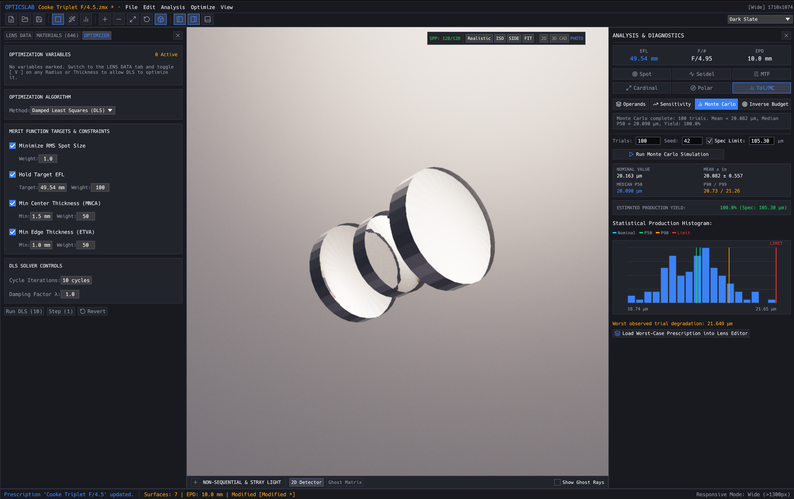

<p align="center">
  
</p>

<h1 align="center">OpticsLab</h1>

<p align="center">
  <b>Modern, open-source academic optical engineering and raytracing CAD workbench, built in pure Rust.</b>
</p>

<p align="center">
  Rigorous sequential raytracing, Seidel aberration analysis, damped least squares optimization,
  non-sequential Monte Carlo simulation, ISO 10110 manufacturing export, and a high-performance native desktop UI.
</p>

<p align="center">
  <a href="https://github.com/AlexCri5an/optics-lab/actions/workflows/ci.yml"></a>
  
  
  
  
  
  
</p>

<p align="center">
  <a href="#a-look-around">A Look Around</a> ·
  <a href="#why-opticslab">Why OpticsLab</a> ·
  <a href="#key-capabilities">Key Capabilities</a> ·
  <a href="#quick-start">Quick Start</a> ·
  <a href="#workspace-architecture">Workspace Architecture</a> ·
  <a href="#built-in-presets">Built-In Presets</a> ·
  <a href="#packaging--releases">Packaging</a> ·
  <a href="#license--attribution">License</a>
</p>

<br>

<p align="center">
  
  <br><sub><b>Sequential Optical Workbench</b>: 2D cross-section ray fan paths, surface curvature controls, and real-time Spot Diagram analysis · <code>Cooke Triplet F/4.5</code></sub>
</p>

---

## A Look Around

<table>
<tr>
<td width="50%" valign="top">
  
  <p align="center"><sub><b>3D Raytracing & Detector Analysis</b>: 3D interactive ray paths, 646-material catalog browser, and non-sequential 2D false-color irradiance heatmap</sub></p>
</td>
<td width="50%" valign="top">
  
  <p align="center"><sub><b>Photorealistic Shading & Statistical Tolerancing</b>: 3D refractive path-traced lens assembly (SPP 128), live DLS optimizer, and Monte Carlo tolerance yield distribution</sub></p>
</td>
</tr>
</table>

---

## Why OpticsLab?

Commercial optical design software (Zemax OpticStudio, Code V) is often expensive, closed-source, Windows-only, and bound by restrictive licensing agreements. 

**OpticsLab** is built from first principles as an open-source, clean-room alternative for optical engineers, physicists, students, and researchers:
* **Clean-Room & Academic Rigor**: All mathematical formulas, paraxial equations, and aberration expansions derive strictly from public academic physics literature (Born & Wolf *Principles of Optics*, Kingslake *Lens Design Fundamentals*, Warren J. Smith *Modern Optical Engineering*) and international standards (ISO 10110).
* **Pure Memory-Safe Rust**: Built entirely in safe, modern Rust (Edition 2024, MSRV 1.87+). Enforces a strict zero-panic policy in production code.
* **Native Cross-Platform Desktop UI**: Powered by `egui` and `wgpu`, providing 60 FPS responsiveness, Retina rendering, and native window management on macOS, Linux, and Windows.
* **Extensible & Automatable**: Features an `OpticsEngine` facade with complete Undo/Redo transactions, a command-line interface (`optics-cli`), and a C-compatible FFI interface (`optics-ffi`).

---

## Key Capabilities

### 1. Sequential Optical Engine
* **3D Skew Raytracing**: Traces exact physical rays through arbitrary spherical, planar, and conic surfaces (prolate/oblate ellipsoids, paraboloids, hyperboloids).
* **Paraxial Solvers**: Solves Effective Focal Length ($EFL$), Back Focal Length ($BFL$), entrance and exit pupil locations/diameters, numerical aperture ($NA$), and transverse magnification.
* **Ray Aiming**: Automatic iteration towards pupil coordinates with both paraxial and real iterative ray aiming.
* **Complex Surfaces**: Even-order polynomial aspheres, biconics, 3D coordinate breaks (Euler angle tilt and decenter), and diffractive optical elements.
* **Apertures & Obscurations**: Circular, rectangular, elliptical, and spider obscuration stops.

### 2. Third-Order Aberration Analytics & Wavefront
* **Seidel Surface Sums**: Complete breakdown of primary Seidel monochromatic aberrations on each optical interface:
  * $S_I$ Spherical Aberration
  * $S_{II}$ Coma
  * $S_{III}$ Astigmatism
  * $S_{IV}$ Petzval Field Curvature
  * $S_V$ Distortion
* **Chromatic Aberrations**: Primary longitudinal ($C_L$) and transverse ($C_T$) chromatic focal shifts across Fraunhofer lines.
* **Geometric Diagnostics**: Transverse ray aberration fan plots ($E_y, E_x$), spot diagram scatter point clouds, and field curvature/distortion curves.
* **Wavefront & Polarization**: Optical Path Difference (OPD) wavefront error maps, Zernike fringe polynomial expansion, and polarized raytracing via Jones calculus and Fresnel amplitude/phase equations.

### 3. Comprehensive 646-Material Glass Catalog
* **Embedded Physical Glass Database**: 646 verified optical materials from leading glass foundries:
  * Schott AG
  * Ohara Corporation
  * CDGM Glass Co.
  * Hoya Corporation
  * Hikari Glass
  * Sumita Optical Glass
* **High-Precision Dispersion Formulas**: Multi-formula dispersion engine supporting Sellmeier (Formulas 1 and 2), extended Cauchy, Schott polynomial, Herzberger, and Conrady models.
* **Catalog Interoperability**: Includes parsers for `.agf` glass catalog files and RefractiveIndex.INFO YAML datasets.
* **Thermal Modeling**: Edlén equation for environmental air refractive index scaling with temperature and atmospheric pressure; glass $dn/dT$ thermal expansion.

### 4. DLS Optimization & Manufacturing Tolerancing
* **Damped Least Squares (DLS)**: Levenberg-Marquardt optimizer with adaptive damping factors for curvature, thickness, air gap, and conic constant optimization.
* **Global & Discrete Optimizers**: Multi-start global search, simulated annealing, and "Glass Hammer" discrete catalog material substitution.
* **Multi-Operand Merit Function**: Targets focal lengths, spot radii, spherical aberration, coma, and center/edge boundary thickness constraints.
* **Manufacturing Tolerancing**:
  * Statistical distributions: Gaussian, Uniform, Parabolic, and Trapezoidal.
  * Operands: Radius of curvature ($TRAD$), thickness ($TTHI$), element tilt ($TILT$), decenter ($TSDX, TSDY$), index ($TIND$), and Abbe number ($TABB$).
  * Sensitivity analysis with finite-difference Pareto ranking.
  * Monte Carlo statistical yield analysis with percentile thresholds (50th, 90th, 98th percentile).
  * Automated inverse tolerance budgeting for Commercial, Precision, and High-Precision manufacturing grades.

### 5. Non-Sequential Monte Carlo Simulation
* **Accelerated Ray Traversal**: Surface Area Heuristic (SAH) Bounding Volume Hierarchy (BVH) with fast ray-triangle and ray-box intersections.
* **Complex Light Sources**: Collimated beams, point sources, Lambertian emitters, and Gaussian laser beams.
* **Physical Interactions**: Fresnel reflection/transmission laws, thin-film anti-reflective (AR) coatings, Total Internal Reflection (TIR) in light pipes and prisms.
* **2D Pixelated Detectors**: Radiometric irradiance (Watts/m²) and photometric illuminance (Lux/Lumens) accumulation with 2D false-color heatmaps and cross-section profiles.
* **Stray Light & Ghost Analysis**: Ray path tracking and classification (transmitted, reflected, ghost focus pairs, TIR).

### 6. CAD & Technical Drawing Export
* **AutoCAD Release 12 DXF**: 2D cross-section technical drawings with lens profile curves, glass hatch patterns, and ray bundles.
* **Scalable Vector Graphics (SVG)**: Publication-ready vector diagrams for academic papers, complete with scale bars and color-coded wavelengths.
* **Wavefront OBJ & STL**: 3D surface tessellation with `.mtl` materials for mechanical CAD integration and 3D printing.
* **ISO 10110 Manufacturing Reports**: Standardized optical element drawing sheets in structured Markdown.

### 7. Modern Academic Desktop UI
* **Academic Dark Theme**: Clean minimalist interface with custom design tokens (`OpticsTokens`).
* **Interactive 2D Viewport**: Real-time cross-section lens layout with pan, zoom, surface sag rendering, ray fan paths, and pupil indicators.
* **3D Viewport**: Orbit camera 3D visualization.
* **Spreadsheet Prescription Editor**: Real-time paraxial solves, variable flags, and solve indicators.
* **Interactive Dock Panels**: Seidel bar charts, ray fan plots, spot diagrams, glass catalog browser, live DLS convergence monitor, and Monte Carlo histograms.
* **100% Typed Vector Icons**: Embedded Lucide vector curves with zero external binary runtime dependencies.

---

## Workspace Architecture

OpticsLab is organized into 12 modular library crates and 2 application entry points:

| Crate / Target | Layer | Description |
| :--- | :---: | :--- |
| [`crates/optics-core`](crates/optics-core) | Layer 1 | Mathematical vectors, paraxial solvers, Seidel sums, ray structures, aspheres, and polarization. |
| [`crates/optics-spectral`](crates/optics-spectral) | Layer 1 | Fraunhofer spectral lines, dispersion models, CIE colorimetry, and thermal Edlén air scaling. |
| [`crates/optics-glass`](crates/optics-glass) | Layer 1 | 646 embedded optical materials, Sellmeier coefficients, AGF and YAML catalog loaders. |
| [`crates/optics-bvh`](crates/optics-bvh) | Layer 2 | Bounding Volume Hierarchy (BVH), SAH construction, triangle ray intersections, and lens tessellation. |
| [`crates/optics-render`](crates/optics-render) | Layer 2 | Headless GPU compute shaders (WGSL), Monte Carlo path tracing, and tonemapping pipelines. |
| [`crates/optics-engine`](crates/optics-engine) | Layer 3 | Optical prescription management, surface sequential raytracer, spot diagrams, and Undo/Redo commands. |
| [`crates/optics-optimize`](crates/optics-optimize) | Layer 3 | Damped Least Squares (DLS) optimizer, merit function evaluation, and parameter variables. |
| [`crates/optics-nonseq`](crates/optics-nonseq) | Layer 3 | Non-sequential Monte Carlo raytracer, 2D detectors, light pipes, and ghost matrix analysis. |
| [`crates/optics-tolerance`](crates/optics-tolerance) | Layer 3 | RSS and Monte Carlo manufacturing tolerance analyzer, sensitivity ranking, and inverse budgeting. |
| [`crates/optics-formats`](crates/optics-formats) | Layer 4 | AutoCAD R12 DXF, SVG publication diagrams, Wavefront OBJ, STL 3D printing, and ISO 10110 reports. |
| [`crates/optics-ffi`](crates/optics-ffi) | Layer 4 | C-compatible FFI bindings (`extern "C"`) and native C header (`include/optics_lab.h`). |
| [`crates/optics-ui`](crates/optics-ui) | Layer 5 | Academic desktop UI (`egui`), 2D/3D viewports, prescription table, analysis dock, and Lucide icons. |
| [`apps/optics-desktop`](apps/optics-desktop) | Layer 6 | Native desktop GUI application executable (`OpticsLab`). |
| [`apps/optics-cli`](apps/optics-cli) | Layer 6 | Command-line interface for batch raytracing, automated optimization, and technical exports. |

---

## Quick Start

### Prerequisites
* [Rust](https://rustup.rs/) (version 1.87 or newer, Edition 2024).

### 1. Launch the Desktop Application
```bash
# Clone the repository
git clone https://github.com/AlexCri5an/optics-lab.git
cd optics-lab

# Run the native desktop workbench
cargo run --release -p optics-desktop
```

### 2. Using the CLI
```bash
# Display help and available commands
cargo run --release -p optics-cli -- --help

# Run raytrace analysis on the Cooke Triplet preset and export an SVG diagram
cargo run --release -p optics-cli -- analyze --preset cooke-triplet --export layout.svg
```

### 3. Running the Test Suite & Quality Gates
```bash
# Format check
cargo fmt --all -- --check

# Strict Clippy validation
cargo clippy --workspace --all-targets -- -D warnings

# Run all unit, integration, and golden regression tests
cargo test --workspace
```

---

## Built-In Presets

OpticsLab includes verified classical optical systems ready for immediate analysis:
1. **Cooke Triplet F/4.5**: The landmark photographic anastigmat designed by H. Dennis Taylor, demonstrating independent correction of all five primary Seidel aberrations.
2. **Double Gauss 50mm F/2.0**: The foundational high-aperture symmetric photographic objective.
3. **Plano-Convex Singlet 100mm**: Classical single-element demonstration for spherical aberration and longitudinal chromatic focal shift.

---

## Packaging & Releases

Native standalone installers can be generated using the scripts in `packaging/`:
* **macOS**: `./packaging/macos/package.sh` generates a signed, drag-and-drop `.dmg` installer with Retina icons.
* **Linux**: `./packaging/linux/package.sh` generates a standalone tarball and desktop entry.
* **Windows**: `powershell -File packaging/windows/package.ps1` builds portable ZIP and WiX MSI installers.

---

## License & Attribution

OpticsLab is dual-licensed under:
* **MIT License** ([LICENSE-MIT](LICENSE-MIT))
* **Apache License, Version 2.0** ([LICENSE-APACHE](LICENSE-APACHE))

Third-party dependencies, icons, and scientific material properties are documented in [`NOTICE`](NOTICE) and [`ASSETS.md`](ASSETS.md).
